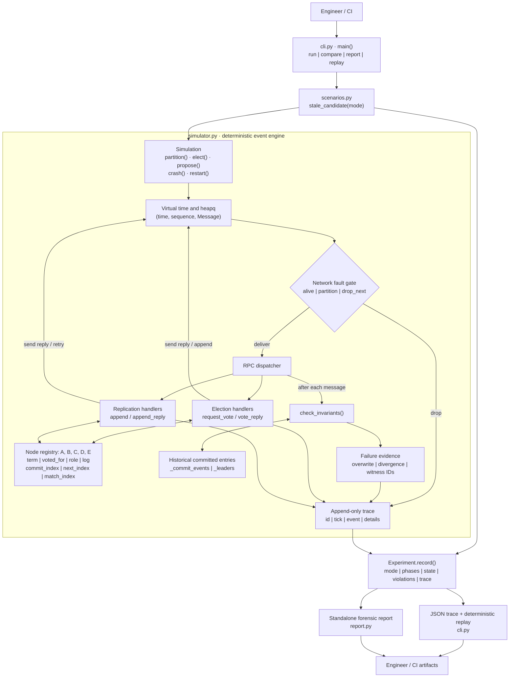
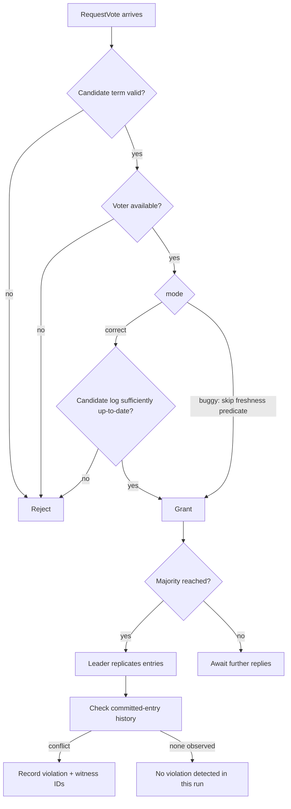

# Low-level architecture · Distributed Consensus Failure Forensics Lab

**Implementation:** single-process Python 3.11+ educational MVP. All five nodes are virtual; there is no socket server or external database.

## Component diagram

## Internal message paths

| Phase | Function | Effect |
|---|---|---|
| Scenario | `stale_candidate(mode)` | Scripts partitions, elections and proposals |
| Send | `Simulation._send()` | Enqueues `Message` at virtual time, preserving FIFO tie order |
| Delivery | `Simulation.run()` | Applies crash, partition and targeted message-drop rules |
| Voting | `_handle_vote_request()`, `_handle_vote_reply()` | Term checks; log-freshness restriction in correct mode; quorum election |
| Replication | `_handle_append()`, `_handle_append_reply()` | Consistency checks, conflict truncation, replication progress, commit advancement |
| Oracle | `check_invariants()` | Compares live logs against immutable historical committed entries; detects cross-node divergence |
| Evidence | `_record()`, `_violate()` | Structured trace events, violation witnesses |
| Output | `Experiment.record()`, `render_html()` | JSON traces, replay verification, local HTML comparison |

## Exact safety-mutation decision

In intentionally unsafe mode, **only** the RequestVote log-freshness predicate is disabled. The fixed scenario shows why electing a stale leader can overwrite previously committed data.

## Key data structures

- `Entry(term, command)`: immutable replicated-log entry.
- `Node`: role, term, previous vote, log, commit index, votes, per-peer matching and next indexes, alive flag.
- `Message(kind, src, dst, term, data)`: simulated RPC envelope.
- `_queue`: virtual delivery heap keyed by timestamp and insertion order.
- `_groups`/`_drops`: fault-injection state.
- `_committed`: historical snapshot of entries committed on each node; intentionally retained even if a live log is truncated.
- `trace`/`violations`: diagnostic events with monotonic event IDs and witness references.

**Scope:** scripted five-node demonstration, not production Raft; no real network, disk persistence, snapshots, automatic elections, model checking or exhaustive verification. The checker finding no failure does not prove consensus correctness. 
